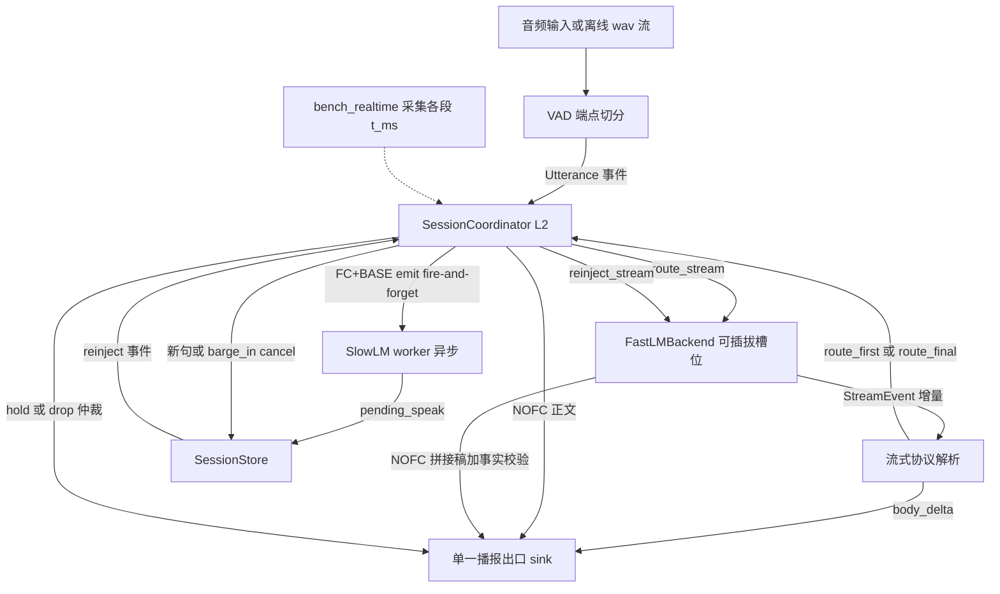

## User Requirements

- 把现有快慢结构里的 FastLM 改造成「偏实时」：路由与播报更早出现，听与说不互相阻塞。
- 实时档位授权按可行性选择：可以是 80–160ms 级 chunk 硬实时，也可以是保留现有整句底座的流式化改造；用户明确表示「根据情况选择」。
- 改动范围全开放：编排层、推理封装、词表与训练、协议字面均可调整。
- 交付必须是可运行原型，并给出改造前后的端到端时延实测对比，而非纯设计文档。

## Product Overview

在保持快慢两圈闭环、单一播报出口与既有协议脊柱的前提下，把「一句话说完才整体出结果」改成「边接收边出路由、端点即切、慢结果异步回注」。用户可感知为首包更快、慢任务不卡住继续说话、新一句可打断旧任务。同时把 FastLM 做成可插拔槽位，使后续硬实时底座升级无需重做编排。

## Core Features

- 流式路由首包：首 token 或音频前缀即给出路由倾向，端点确认后出最终路由，不再等整段生成完毕。
- 端点早切与打断：静音端点、最短/最长句、新句取消旧任务、播报挂起与恢复。
- 慢路径真异步：上派后继续听，结果经回注事件进入统一播报出口，不阻塞快时钟。
- 可插拔 FastLM：整句流式底座与首 token 门控底座共用同一事件契约，可横向对比。
- 时延与质量对比报告：分段时延、路由正确率、回注事实保真，改造前后同集实测。

## Tech Stack Selection

沿用仓库现有栈，不引入新框架或常驻服务：Python 3 + PyTorch + transformers（Step 侧用 `/cmy/cmy/Step-Audio/venv/bin/python`，SlowLM 侧用 `qwen3-compare` 并保留 `PYTHONPATH` 隔离，两个解释器绝不混装 transformers）。新增依赖为零或已有：`TextIteratorStreamer`（transformers 自带）、`numpy`、`librosa`、`edge-tts`（`step_route/gen_step_backend.py` 已用）、`soundfile`（已在造数路径使用）。不引入 Redis / 消息队列 / Web 服务；SessionStore 用进程内 dict，接口形状稳定后再替换。

## Implementation Approach

### 路线选择（用户已授权按可行性决定）

**主交付走「保留 Step 整句底座 + 流式解码 + L2 编排」，并并行提供「MiniCPM5 S2 首 token 门控 + 前缀 chunk 路由探针」作为硬实时台阶与对照组**；真 80–160ms chunk-causal 明确列为本轮之后的阶段。理由与代价：

- 已核查 `/cmy/cmy/Step-Audio/Step-Audio2/stepaudio2.py`：`StepAudio2.__call__`（L14–58）是整段 `self.llm.generate`，官方目录无流式 API；但实例对外暴露 `.llm` / `.llm_tokenizer` / `.apply_chat_template` / `.eos_token_id`，因此**可在 workspace 内复用 `apply_chat_template` 自行拼 `prompt_ids` 与 `mels`，挂 `TextIteratorStreamer` 做增量首 token 回调**，完全不修改外部 Step-Audio 目录。低风险、可跑、可测。
- `MiniCPM5Audio`（`ranAudio/model.py`）词表已用 `CHAT_SPECIAL_TOKENS` 一次性加齐六个 S2 token，`eval_s2.py` L38–67 证明首 token 即 FC 或 NOFC、`mix_llmcont` 上 route_acc 1.0。这是**真正的 token 级门控**，正好承接「边听边出路由」。权重加载可直接复用 `eval_s2.py` L91–117 的 `from_pretrained` + `llm_final.safetensors` 写法与 `paths.py` 常量。
- 真 chunk-causal 硬实时**本轮不落地**：`SenseVoiceEncoderSmall.forward`（`sensevoice_apm.py` L543）是整段前向；`forward_chunk`（L398 / L226）虽带 cache 与 chunk_size，但 `SenseVoiceAPM.encode_wavs`（L734）从未接入，且 `docs/S1.5_SenseVoice_训练计划.md` L156 明确「不训流式 chunk-causal（S1）」、`docs/architecture.md` §5 记 S1「未做」。不重训 S1 直接用 chunk 权重会破坏已验的 route 1.0；而 S1 重训是独立训练工程，无法在「原型 + 时延报告」这一交付里验证，blast radius 过大。故本轮用**前缀 chunk 增量重编码 + 只生成 1–2 token 的路由探针**近似「边听边出路由」，并在报告中标注精度与复杂度边界，把 S1 重训列为后续阶段。

### 关键决策

1. **可插拔 FastLM 接口**（SoC / 可扩展）：定义 `FastLMBackend` 协议，两种后端产出同一 `StreamEvent` 流；coordinator 只认事件不认模型，后续换真 chunk 底座只新增一个实现。
2. **事件驱动替代同步 await**：现有 `pipeline.py` L92 同步等 SlowLM、L109 同步回注，自注 "offline run is sequential"。改为「FC+BASE 读到即 emit 事件 → 立刻回到听 → SlowLM 结果作为 pending_speak 事件 → 回注事件 → 单一播报出口」，兑现四条铁律中的 fire-and-forget 与唯一出口。
3. **增量解析处理半截 special token**：现有 `parse_s2_output` 是整串前缀解析加软恢复（`protocol_step.py` L95–105），无法用于流式；新增逐 token 累积解析器，路由一旦确定即发 `route_first`，转写与正文按 delta 发。
4. **回注事实保真加固**：实测 `/tmp/step_route_results.json` 三次回注无一输出合规 NOFC，且股价句把「演示结果」洗成确定数字。用 `protocol.py::entity_fidelity` 做数字/专名校验，不通过则退回结构化拼接（衔接词 + 原样 speak），不再让生成模型裸拷贝事实；同时收敛 `protocol_step.py::_cut_body` 误吞合法正文的问题。
5. **VAD 用能量/静音法**，纯 numpy、无需模型与额外权重，落在 §4.1 的 400–600ms 端点、约 300ms 最短句、15s max_utt 契约上；AEC 与真实麦克风采集本轮不做（报告标注为真实硬实时的前置条件，避免常开麦自激被误判）。
6. **保留同步 `StepRoutePipeline` 作为基线**，只新增 `RealtimePipeline`；`demo_step_route.py` 增 `--mode` 分支，默认行为不变，保证 `/tmp/step_route_results.json` 可复现。

### 性能与复杂度

- Step 流式解码把「等 256 token 全生成」降为「首 token 回调」，prefill 仍是整句 O(T)，收益来自提前 emit 而非缩短编码；实测基线 fast 段 1.3–3.8s，可优化的是 emit 时刻与 TTS 首包，而非 prefill 本身，报告中如实区分。
- 前缀 chunk 探针为 O(k²) 重编码（k = chunk 数，每 chunk 重算累计前缀 mel 与音频帧），对 ≤15s 短句可接受；设 chunk 上限、早停（路由连续两次一致即停）、以及「仅 FC 候选未定时才跑探针」，避免每 chunk 全量生成与 N+1 式重复 encode；缓存 mel 前缀与 tokenize 结果。
- 两模型同机存在 GPU 争用：coordinator 串行化 FastLM 单例调用，SlowLM 保持独立子进程；回注与 route 不并发抢同一实例。
- 复杂度瓶颈明确写在报告：整句底座的上限是端点后 prefill，前缀探针的上限是 O(k²) 重编码，真 80–160ms 需 S1 重训。

### 避免技术债

复用 `ranAudio/protocol.py` 的 FC/NOFC/BASE/backend 常量、`cer`、`entity_fidelity`、`assistant_token_weights`；复用 `model.py::MiniCPM5Audio` 与 `eval_s2.py` 的权重加载写法、`paths.py`、`_boot.py` 导入约定、`slowlm.py` 的子进程 worker 模式、`gen_step_backend.py` 的 edge-tts + Qwen3-TTS 回退。新增模块集中在 `ranAudio/step_route/`，对现有文件仅做向后兼容的增量修改，不改外部 Step-Audio 目录、不重训、不推翻 §3.2 协议脊柱（新增事件而非改字面）。

## Implementation Notes

- 每个新增模块首行按仓库约定 `import ranAudio._boot`（`_boot.py` 把项目与 MiniCPM-o-Demo 加入 sys.path），否则从 `python -m` 运行时导入失败。
- 日志沿用 `print(..., flush=True)` 风格，每条带 `request_id`；不打印 wav 路径以外的大 payload、不打印原始 PCM；慢路径错误记为可行动的单行摘要，避免逐 token 刷屏。
- 打通 `request_id`：`pipeline.py` L53 生成的 id 当前只写进 `TurnResult`，`slowlm.py` L171 另生成 uuid；本轮让 client `speak(transcript, request_id=...)` 透传，worker 回包带回同一 id，`slowlm.py` L214–217 丢弃过期结果的逻辑改为按 id 判定 cancel，并补 `cancel(request_id)` 与超时回落，消除静默丢弃。
- hot path：VAD 按 20–30ms 帧推进、mel 前缀缓存、探针早停、FastLM 调度串行化；避免对同一 wav 重复 librosa 载入。
- Blast radius：新增文件为主；`pipeline.py` / `slowlm.py` / `demo_step_route.py` / `protocol_step.py` / `fastlm.py` 为增量修改且保留原路径行为；`STEP_ROUTE.md` 仅同步 §7 / §9 现状与指向，不重写契约。所有新行为默认由 `--mode` 显式开启。

## Architecture Design



分层不变：L0（VAD，AEC 留空）→ L1（FastLMBackend）→ L2（SessionCoordinator + SessionStore + 流解析 + 仲裁）→ L3（SlowLM worker）→ 播报 sink。快慢不共享 KV，唯一真相在 SessionStore，兑现 §5 字段契约（session_id / history_text / last_transcript / request_id / pending_speak / anchor_time）。

## Directory Structure

整体：在 `ranAudio/step_route/` 内新增流式运行时（事件、解析、VAD、Store、两个后端、coordinator、基准、测试、文档），对 5 个现有文件做向后兼容的增量修改。

```
/cmy/cmy/ranAudio/
└── ranAudio/
    └── step_route/
        ├── events.py             # [NEW] 事件与数据契约：StreamEvent（kind/request_id/t_ms/text/route）、Utterance、TurnResult 扩展字段与时间戳工具；所有模块共享的唯一事件模型。
        ├── stream_protocol.py    # [NEW] 增量 token 到事件的流式解析器；复用 protocol.py 常量；处理半截 special token；首 token 定路由即发 route_first；提供 backend 事实保真校验与结构化拼接兜底。
        ├── vad.py                # [NEW] 纯 numpy 能量/静音端点切分：尾静音 400-600ms 可配、最短句约 300ms、max_utt 15s、barge_in 重开缓冲；产出 Utterance 并可回放离线 wav 切片。
        ├── session_store.py      # [NEW] 落地 §5 契约的进程内 dict：六字段读写、request_id 生命周期、cancel 清 pending_speak、anchor_time 仲裁、history_text 追加；接口稳定后可换 Redis。
        ├── fastlm_base.py        # [NEW] FastLMBackend 协议与公共工具：定义 route_stream / reinject_stream 签名、事件封装、模型加载失败回退；coordinator 只依赖此协议。
        ├── fastlm_stream.py      # [NEW] Step 流式后端：复用 StepAudio2.apply_chat_template 拼 prompt_ids 与 mels，挂 TextIteratorStreamer 在独立线程 generate；workspace 内实现，不修改外部 Step-Audio 目录。
        ├── fastlm_minicpm.py     # [NEW] MiniCPM5 S2 后端：按 eval_s2.py L91-117 加载 mix_llmcont 与 S1.5 enc/proj；首 token 真门控；支持前缀 chunk 增量重编码加 1-2 token 路由探针（含早停与 chunk 上限）。
        ├── coordinator.py        # [NEW] L2 编排：真 fire-and-forget、request_id 打通、hold/drop/用户优先仲裁、pending_speak 回注调度、单一播报出口 sink（文本记录加可选 edge-tts）；产出 RealtimePipeline。
        ├── pipeline.py           # [MODIFY] 保留同步 StepRoutePipeline 作基线不动；新增 RealtimePipeline 入口委托 coordinator；TurnResult 增加分段时延字段，保持 to_dict 兼容。
        ├── fastlm.py             # [MODIFY] 抽出 prepare_inputs(messages) 供 Step 流式后端复用 apply_chat_template 结果的 tokenize 与 mel 拼接（DRY），原 route/reinject 行为不变。
        ├── slowlm.py             # [MODIFY] speak 接受并回传 request_id；新增 cancel(request_id)；worker 支持并发 id 与过期结果判定；修复超时后结果静默丢弃；SLOW_SYSTEM 占位文本保持不变以免混入训练变量。
        ├── protocol_step.py      # [MODIFY] 修复 _cut_body 遇 stop token 截断合法正文的问题；暴露事实保真校验入口供 stream_protocol 复用；保留 parse_s2_output 原语义。
        ├── demo_step_route.py    # [MODIFY] 增加 --mode baseline|step-stream|minicpm-probe 与 --report 输出；默认行为不变；复用现有 _default_wavs 与结果 JSON 写出。
        ├── bench_realtime.py     # [NEW] 三模式基准 harness：同一批 wav 采集 endpoint 到 route_first / first_speak / total 等分段时延、route_acc、回注事实保真；输出 JSON 与 Markdown，对齐 /tmp/step_route_results.json 基线。
        ├── test_realtime.py      # [NEW] no-GPU 单测：半截 token 流解析、VAD 切分边界、SessionStore cancel 与仲裁顺序、事实保真兜底；沿用 test_protocol_step.py 的 main+assert 风格可单独运行。
        ├── REALTIME_FASTLM.md    # [NEW] 设计说明、运行命令、改造前后时延对比表、精度与复杂度边界、S1 chunk-causal 与 Step SFT 的后续阶段清单。
        └── STEP_ROUTE.md         # [MODIFY] 仅同步 §7 现有代码表与 §9 已做/未做状态，并指向 REALTIME_FASTLM.md；不改写 §1-§6 协议契约。
```

## Key Code Structures

以下两个接口为多模块共同依赖的契约，需精确定义（仅签名，无实现）：

```python
# ranAudio/step_route/events.py —— 流式事件契约
@dataclass(frozen=True)
class StreamEvent:
    kind: Literal["route_first", "transcript_delta", "body_delta",
                  "route_final", "speak", "done", "cancelled"]
    request_id: str
    t_ms: float                 # 相对本句起点的单调时钟，供 bench 采集分段时延
    text: str = ""
    route: Optional[Literal["fc", "nofc", "other"]] = None

# ranAudio/step_route/fastlm_base.py —— 可插拔 FastLM 槽位
class FastLMBackend(Protocol):
    def route_stream(self, wav: Path, request_id: str) -> Iterator[StreamEvent]: ...
    def reinject_stream(self, speak: str, wav: Optional[Path],
                        request_id: str) -> Iterator[StreamEvent]: ...
```

## Agent Extensions

### SubAgent

- **code-explorer**
- Purpose: 在实施第一步批量核查 `StepFastLM` / `StepRoutePipeline` / `SlowLMClient` / `demo_step_route.py` 的全部调用点与 import 链，以及 `MiniCPM5Audio` 权重加载（`eval_s2.py`、`infer.py`）的既有写法，确认新增模块不会破坏离线基线。
- Expected outcome: 产出一份可复用的「调用点与依赖清单」，直接用于第一个里程碑的基线固化与后续增量修改的影响面控制；后续每个改动文件都对照该清单校验向后兼容。