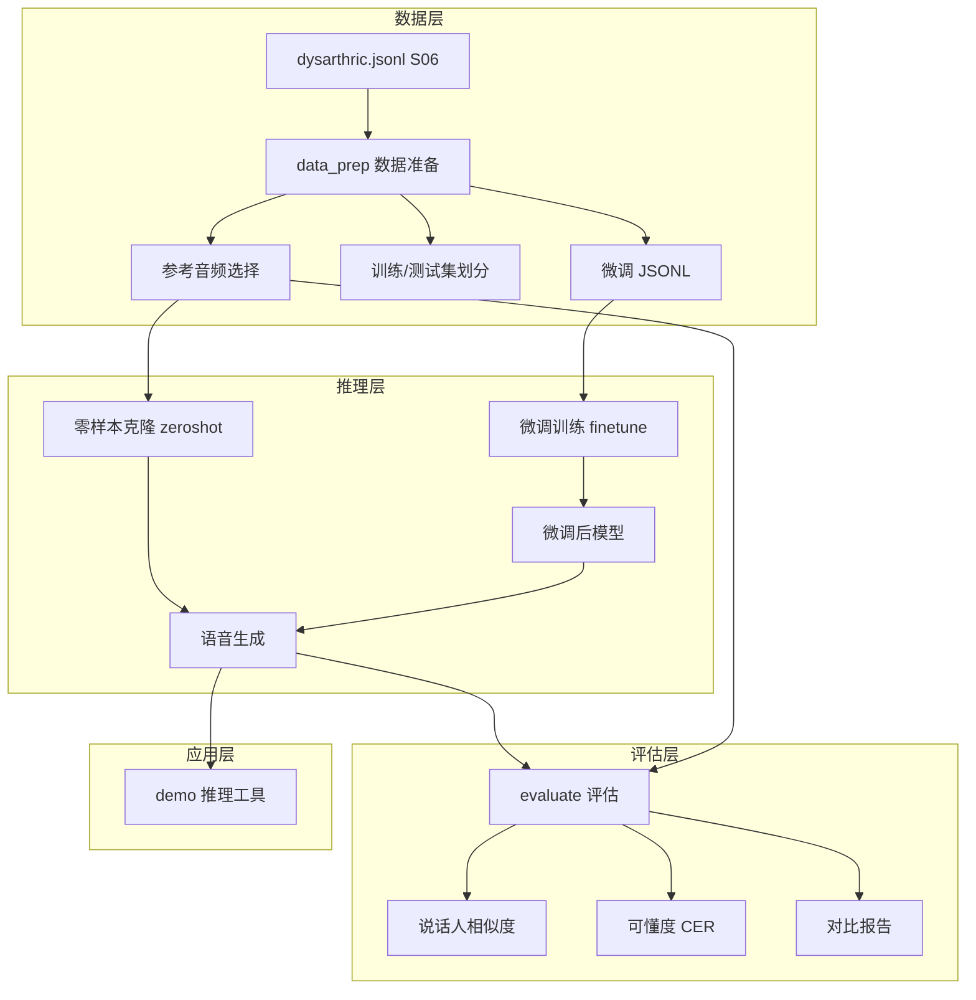

## Product Overview

构音障碍患者音色克隆系统（试点：S06 说话人）：以构音障碍（dysarthria）患者的录音为参考克隆其音色，输入新文本后生成该患者音色的清晰语音（TTS 方向），帮助患者用"自己的声音"说清楚话。系统基于 Qwen3-TTS 实现，包含完整训练流程与推理 Demo。

**试点范围**：先以 S06 说话人（9,278 条，6.26h）为试点跑通全流程，验证效果后再扩展到其他说话人。

## Core Features

- **数据准备与参考音频选择**：解析 MDSD 构音障碍数据集 S06 说话人数据，筛选参考音频，生成零样本克隆与微调所需数据
- **零样本音色克隆**：基于 Qwen3-TTS `generate_voice_clone` API，以构音障碍录音为参考，输入新文本生成清晰语音；支持 `x_vector_only_mode` 纯音色提取模式
- **按说话人微调**：针对 S06 执行单说话人 SFT（prepare_data 提取 audio_codes → sft_12hz 训练），提升音色相似度
- **效果评估**：说话人相似度（ECAPA-TDNN cosine）、可懂度（ASR CER）、零样本 vs 微调对比报告
- **推理 Demo**：输入说话人 ID + 文本 → 输出克隆语音 wav 的 CLI 工具
- **调研与使用文档**：方案调研总结 + 完整 pipeline 使用说明

## Visual Effect

系统为后端 ML pipeline，无 UI 界面。产出为：

- S06 说话人的合成语音 wav 文件（输出目录按模式组织）
- 评估对比报告（Markdown 格式，含各指标数值和音频样例路径）
- 命令行 Demo，支持单条/批量推理

## Tech Stack

- **语音合成模型**: Qwen3-TTS-12Hz-0.6B-Base（本地已部署，支持零样本 voice clone + 单说话人微调）
- **语音 Tokenizer**: Qwen3-TTS-Tokenizer-12Hz（提取 audio_codes 用于微调）
- **深度学习框架**: PyTorch + `qwen-tts` Python 包
- **说话人相似度评估**: speechbrain ECAPA-TDNN（spkrec-ecapa-voxceleb）
- **可懂度评估**: ASR 转写 + CER 计算（复用项目已有 FunASR / WeNet 能力）
- **音频处理**: soundfile, librosa
- **运行环境**: NVIDIA H800 80GB（~22GB 空闲），conda/miniconda3

## Implementation Approach

### 总体策略：零样本优先，微调增强

**核心洞察**：Qwen3-TTS 预训练模型天然生成清晰语音。`generate_voice_clone` 的 speaker encoder 从构音障碍参考音频中提取说话人音色向量，generator 以新文本为条件生成清晰语音——这正好满足"保留音色、输出清晰"的目标。

**两阶段路线**：

1. **阶段一（零样本基线）**：直接用 S06 构音障碍音频做 `generate_voice_clone`，对比 `x_vector_only_mode=True/False` 两种模式。`x_vector_only_mode=True` 仅提取说话人向量（不迁移构音韵律/风格），对构音障碍参考更友好。预期零样本已可产出清晰语音。
2. **阶段二（微调增强）**：若零样本音色相似度不足，对 S06 微调。关键注意：微调目标（`audio` 字段）若用原始构音语音，模型可能学到构音特征。缓解策略：

- 使用低学习率（2e-6）+ 少 epoch（3-5）保留预训练模型的清晰语音生成先验
- 训练数据的 `text` 是期望文本（非构音转写），文本条件驱动清晰发音
- 对比零样本和微调结果，选择更优方案

### 性能与可靠性

- **模型规模**：0.6B 参数，bf16 推理，单卡 H800 足够训练和推理
- **批量推理**：使用 `create_voice_clone_prompt` 预提取说话人 prompt，避免重复编码参考音频
- **数据量**：S06 有 9,278 条（6.26h），微调取子集（~2000-3000 条）即可，避免过拟合
- **参考音频选择**：选 1-3 条较长（>3s）且相对清晰的音频作为 ref_audio，保证 speaker embedding 质量

## Architecture Design



### 模块划分

- **数据准备模块** (`data_prep.py`)：数据解析、参考音频筛选、数据集划分、微调 JSONL 生成
- **零样本克隆模块** (`zeroshot.py`)：Qwen3-TTS 模型加载、voice clone 推理、批量生成
- **微调模块** (`finetune.py`)：整合 Qwen3-TTS finetuning 工具链（prepare_data + sft_12hz），按说话人训练
- **评估模块** (`evaluate.py`)：说话人相似度、CER、对比报告生成
- **Demo 模块** (`demo.py`)：CLI 推理入口

### 数据流

```
dysarthric.jsonl (S06) → 选参考音频 + 划分数据集
    ├→ 零样本: ref_audio + new_text → generate_voice_clone → wav
    └→ 微调: {audio, text, ref_audio} JSONL → prepare_data → sft_12hz → model
                                          → generate_custom_voice → wav
                                                          → evaluate → report
```

## Implementation Notes

- **模型路径**：`/cmy/cmy/Qwen3-TTS/Qwen3-TTS-12Hz-0.6B-Base/`（推理 + 微调初始化），`/cmy/cmy/Qwen3-TTS/Qwen3-TTS-Tokenizer-12Hz/`（微调数据准备）
- **微调工具**：`/cmy/cmy/Qwen3-TTS/finetuning/prepare_data.py` 和 `sft_12hz.py`，以 subprocess 调用或直接 import
- **数据索引**：`/cmy/cmy/ranAudio/data/dysarthric.jsonl`，音频在 `/cmy/data/after_catting/10h/Audio/06/{utt}.wav`
- **GPU 显存**：0.6B 模型 bf16 推理约需 3-4GB，微调约需 12-16GB，当前 22GB 空闲足够
- **评估模型**：ECAPA-TDNN 需额外下载（~80MB），FunASR 已在环境中有安装
- **输出目录**：`runs/voice_clone/S06/{mode}/`（mode = zeroshot_xvec / zeroshot_icl / finetuned）
- **微调数据量**：取 2000-3000 条训练 + 200 条测试，避免微调过拟合和训练时间过长
- **关注点**：微调后模型可能学到构音特征导致输出不如零样本清晰，评估环节必须包含可懂度 CER 对比

## Directory Structure

```
/cmy/cmy/ranAudio/
├── ranAudio/
│   └── voice_clone/                # [NEW] 构音障碍音色克隆模块
│       ├── __init__.py             # [NEW] 模块初始化，导出核心接口
│       ├── config.py               # [NEW] 配置：模型路径、数据路径、超参数、输出路径常量
│       ├── data_prep.py            # [NEW] 数据准备。解析 dysarthric.jsonl S06；筛选参考音频；
│       │                           #   划分 train/val/test；生成微调 JSONL
│       ├── zeroshot.py             # [NEW] 零样本克隆。加载 Qwen3-TTS；voice clone 推理
│       ├── finetune.py             # [NEW] 微调流程。prepare_data + sft_12hz
│       ├── evaluate.py             # [NEW] 效果评估。ECAPA-TDNN 说话人相似度；ASR CER
│       ├── demo.py                 # [NEW] 推理 Demo CLI
│       └── utils.py                # [NEW] 工具函数
├── data/
│   └── dysarthric.jsonl            # [已有] 构音障碍数据索引
├── runs/
│   └── voice_clone/                # [NEW] 输出目录
│       ├── S06/
│       │   ├── ref/                # 参考音频
│       │   ├── zeroshot_xvec/     # 零样本（x_vector_only）输出
│       │   ├── zeroshot_icl/      # 零样本（ICL）输出
│       │   ├── finetuned/          # 微调模型输出
│       │   └── checkpoint/         # 微调 checkpoint
│       └── eval_report.md          # 评估对比报告
└── docs/
    └── voice_clone_research.md     # [NEW] 调研报告 + 使用文档
```

## Key Code Structures

### 微调 JSONL 数据格式

```
{"audio": "/path/to/S06_utt1.wav", "text": "期望文本", "ref_audio": "/path/to/S06_ref.wav"}
```

### 核心推理接口（zeroshot.py）

```python
class VoiceCloneInferencer:
    def __init__(self, model_path: str, device: str = "cuda:0"): ...
    def create_prompt(self, ref_audio: str, ref_text: str,
                      x_vector_only: bool = True) -> list: ...
    def generate(self, text: str, prompt: list,
                 language: str = "Chinese", **kwargs) -> tuple[np.ndarray, int]: ...
    def batch_generate(self, texts: list[str], prompt: list, ...) -> list[tuple]: ...
```