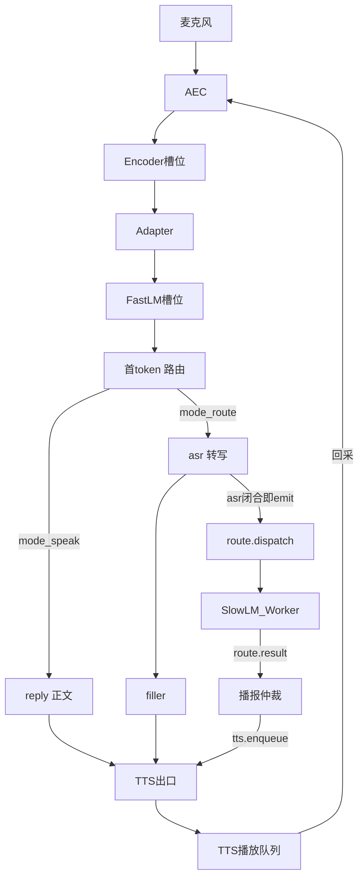

# ranAudio 架构说明

> **日期**：2026-09-13  
> **架构标准**：[MiniCPM5-2B_音频门控架构定义.md](./MiniCPM5-2B_音频门控架构定义.md)（Draft v0.2）。**整体链路与协议以该文 §3.2 为准。**  
> 本文是实现对照：槽位怎么填、代码到哪、训练阶段怎么挂。不另起一套数据流，不改定义里的 OPEN / ASSUMPTION。  
> 代码：[`ranAudio/`](../ranAudio/)。Demo（平级）：[`../MiniCPM-o-Demo`](../../MiniCPM-o-Demo)。

版本契约（历史，不是目标链路）：[v1.0.md](./v1.0.md) · [v1.1.md](./v1.1.md) · [docs/README.md](./README.md)  
2B 原生 XML FC 实测：[minicpm5_fc_format.md](./minicpm5_fc_format.md)  
S1.5：[S1.5_SenseVoice_训练计划.md](./S1.5_SenseVoice_训练计划.md)  
S2 本版协议：[S2_FC_NOFC_训练计划.md](./S2_FC_NOFC_训练计划.md)

---

## 1. 标准在说什么

全双工语音交互：**快时钟 FastLM** 常驻，负责听、说、判断「要不要执行命令」；需要推断 / 规划 / 工具时，**慢时钟 SlowLM** 异步一轮 function call。分工原则见定义 §1.1：谁强谁承担推断。

非目标（定义 §1.3，实现不得做）：2B 出语音 token、2B 多步规划、主动交互、视觉。v0.1 只做一轮 FC。

核心决策是 **条件性 ASR**（定义 §2）：转写是 FastLM 输出流里的一段，不是前置模块。speak **不产生转写**；只有 route 才吐 `<asr>`，且 `<asr>` 是上派的唯一文本源。旁路 ASR 若有，只给 UI，不得参与上派（§2.5）。

---

## 2. 目标链路（定义 §3.2）

§3.2 是唯一脊柱。协议、时钟、状态机都挂在这张图上。



四条铁律（定义 §3.2.1），实现不得走样：

1. `</asr>` 闭合即 emit，不等 `<filler>`。
2. emit 必须 fire-and-forget；快时钟不得 `await` Worker / 工具。
3. 回注是事件，不是出声；出声由播报仲裁决定。
4. speak 的 `<reply>`、route 的 `<filler>`、Worker 的 `speak` 只进同一个 TTS 出口。

分层：L0 信号（AEC / 麦 / TTS）→ L1 实时（Encoder + FastLM）→ L2 协调（流解析 / 总线 / 状态机 / 仲裁）→ L3 SlowLM Worker → L4 应用。详见定义 §3.1、§3.2.2。

时钟：快 80–160 ms，永不阻塞；慢 0.5–5 s，可取消（§5）。状态：`LISTEN` / `SPEAK` / `ROUTE_WAIT` / `DUAL` / `BARGE_IN`（§6）。用户正在说时不插播。

---

## 3. 输出协议（定义 §4 → 本版落地）

定义 §4 的四段仍是标准语义。本版 S2 **字面**改成 special token，对照见 [S2_FC_NOFC_训练计划.md](./S2_FC_NOFC_训练计划.md)。

| 定义 §4 | 本版 | 消费 |
|---|---|---|
| `<mode:route><asr>…</asr>` | `<|FC|><|BASE|>` + 转写 | eos 即上派 |
| `<mode:speak><reply>…</reply>` | `<|NOFC|>` + 理解（闲聊或听写） | 本地，不上派 |
| `<filler>` | 本版 2B 不出 | 协调层以后再定 |
| （未写） | `<|FC|><|LOCAL|>` + `<function>` | **只留 token，本版不训** |

```text
命令：  <|FC|><|BASE|>打开蓝牙
理解：  <|NOFC|>今天天气不错，适合出门。
听写：  <|NOFC|>今天会议取消了
```

`<|FC|>` 只表示命令；本版第二 token 固定 `<|BASE|>`（一律上抛）。听写归 NOFC，不是 FC。S2 **不要** 传 `tools=`，不要走 v1.1 JSON。

解析约束仍按定义 §4.2。上派 / 回注字段见 §4.3 / §4.4。  
[`protocol.py`](../ranAudio/protocol.py) 里的 `<mode:*>` 常量是旧草稿，S2 开训前改成上述 token。

---

## 4. 槽位填充（定义 §3.2.4）

型号是候选，可换；换了只重做 §10 训练规格，链路与协议不变。

| 槽位 | 必须满足 | 当前填充 | 代码 |
|---|---|---|---|
| Encoder | 流式、chunk-causal；AEC 残差 → 音频表示 | **SenseVoice-Small**（512-d；Whisper 仅 v1.0 对照） | [`sensevoice_apm.py`](../ranAudio/sensevoice_apm.py) |
| Adapter | 音频表示 → FastLM 隐空间 | `Linear 512→2048` projector | [`model.py`](../ranAudio/model.py) |
| FastLM | 端侧常驻；**首 token** 即 `<mode:speak\|route>` | MiniCPM5-2B（冻结，S2 才 LoRA） | 同上 |
| SlowLM | 一轮 FC → 回填 → speak；可按 `request_id` 取消；可 `no_op` | 候选 Qwen3.5-27B；现网仍是 Demo Slave | 未按 §3.2 接线 |
| TTS | 文本进、音频出 + 回采给 AEC | **OPEN** | 未做 |

栈（已实现的 L1 离线前向）：

```text
wav 16kHz
  → SenseVoice frontend（80-mel + LFR 7/6）+ SANM encoder（512）
  → MultiModalProjector（512 → 2048）
  → 替换 chat 中 <|audio_pad|> embedding
  → MiniCPM5-2B
```

维护：

- 默认 `encoder_backend=sensevoice`。`--encoder-backend whisper` 仅 v1.0 对照；Whisper 须 pad 到 3000 mel 再 crop。
- 禁止加载 `runs/align/`、`runs/fc/` 的 Whisper 1024-d projector 到 SenseVoice 路径。
- `generate_text` 须 `skip_special_tokens=False`（`<function` / `<mode:` 都是或将是特殊/结构标签）。
- 底座出 XML FC 靠 `tools=` 进 chat template，格式是 `<function`…`</function>`，不是 `<tool_call>` JSON。S2 路由训练 **不要** 传 `tools=`，否则会跳过 `<mode:*>` 直接出 XML。见 [minicpm5_fc_format.md](./minicpm5_fc_format.md)。

---

## 5. 训练阶段（定义 §10）

针对当前 FastLM 候选。2B **不得全参**。

| 阶段 | 定义目标 | 实现状态 |
|---|---|---|
| S0 模态对齐 | 冻 2B，训 encoder + adapter | 被 S1.5 取代（SenseVoice 已预训练） |
| S1 流式化 | encoder 改 chunk-causal | **未做** |
| **S1.5 ASR** | 冻 2B，大规模转写沉到 encoder | **进行中**：a 完成；b-S 完成；b-MS 未开。计划见 [S1.5_SenseVoice_训练计划.md](./S1.5_SenseVoice_训练计划.md) |
| S2 三任务 SFT | LoRA；对话 / 路由 + 少量转写 | **未开**。本版标签见 [S2_FC_NOFC_训练计划.md](./S2_FC_NOFC_训练计划.md)，不是 v1.1 JSON |
| S3 路由校准 | 扫 operating point | 未做 |
| S4 双工专项 | 重叠 / 回声 / 打断 | 未做；定义明确此时才碰 duplex |

S1.5 结束时模型「只会转写」是预期。S2 才解锁 `<|FC|>` / `<|NOFC|>`。BASE 后转写 loss 0.1–0.3，路由 token ≥ 1.0。负例：2B 能答对的标 NOFC（定义 §10.4）。Wenet **不加** 路由标签。

脚本：

| 阶段 | 脚本 | 说明 |
|---|---|---|
| S1.5 | [`train_s15_asr.py`](../ranAudio/train_s15_asr.py) | 冻 2B；SenseVoice + 新 projector；`--keep-best 5` |
| Align / FC / Judge | `train_align.py` / `train_fc.py` / `train_judge.py` | **历史**。Whisper 对齐与 v1.0/v1.1，不进 §3.2 主路径 |

---

## 6. 实现进度（对照标准）

| 标准块 | 状态 |
|---|---|
| L1 Encoder + Adapter + FastLM 离线前向 | 有。SenseVoice + projector + 2B |
| S1.5 转写沉淀 | a / b-S 已跑；出门线已过；全量 AISHELL / test_net / 车机 22 未收官 |
| §4 标签常量与解析 | `protocol.py` 仍是 `<mode:*>` 草稿；本版 token 见 S2 计划，**尚未**改代码 / 造数 / 开 LoRA |
| L0 AEC / 麦 / TTS / 回采 | **不做**（直至 S4；定义 §1.3） |
| L2 流解析 / 总线 / 五状态 / 播报仲裁 | **未做** |
| L3 SlowLM Worker（`route.dispatch` / cancel / `no_op`） | **未做**。现有 Slave 是 v1.1 同步 HTTP，不是 fire-and-forget |
| 字幕旁路 | 未做 |

当前可跑的是 **离线单轮**：一条 wav → `generate` → 文本。不是全双工主循环。不要把 `infer.py` 的 Slave 调用写成 §3.2 的 Worker。

---

## 7. 历史基线（不是目标链路）

v1.0 / v1.1 只保留作对照和回归，**不得**当 §3.2 的实现规格。

| | v1.0 | v1.1 | 目标（定义 §3.2） |
|---|---|---|---|
| 2B 输出 | MiniCPM5 XML `<function>` | `{"asr","need_fc","reply?"}` | 本版 `<|FC|><|BASE|>` / `<|NOFC|>`（对齐定义 speak/route） |
| 转写 | 无（直接出工具） | **两边都有 asr** | **仅 route** 有 `<asr>` |
| 执行 | 2B 填槽后停 | `need_fc` 才打 Slave | `</asr>` 闭合 fire-and-forget → SlowLM |
| 交互 | 离线单轮 | 离线单轮 | 全双工快/慢时钟 |
| 评测 | car_fc **22/22** | 判官（权重未强制开训） | §9 召回 / CER / 实体保真 |

MiniCPM-o 全双工（Gateway + 1s unit + FCAssembler）是另一条产品线，listen/speak/FC **不得**下沉到 Gateway。和 ranAudio 版本号独立。

缺必填槽（`destination` / `level` / `degrees`）仍由 Registry 失败，禁止静默默认——这条对 SlowLM 同样成立。

---

## 8. 产物

| 产物 | 路径 | 用途 |
|---|---|---|
| S1.5b-S 最好 encoder / projector | `runs/s15_asr/b_s/encoder_best.pt`、`projector_best.pt` | 进 S1.5b-MS / 日后 S2 |
| S1.5a projector | `runs/s15_asr/a/projector_best.pt` | b-S 起点 |
| S1.5 日志 | `runs/s15_asr/b_s/train.log`、`ckpts.json` | 只留 CER 最好 5 对 |
| v1.0 Align / FC | `runs/align/projector.pt`、`runs/fc/` | Whisper 基线，禁止接到 SenseVoice |
| v1.1 判官 | `runs/judge/`、`data/judge_audio.jsonl` | 历史；S2 不要打补丁 |
| 评测 | `tmp/minicpm5_car_fc_eval.json`、`tmp/minicpm5_fc_probe.json` | v1.0 / 底座 XML 探针 |

S2 只读 S1.5 在 MS 上 CER 最好的 `encoder.pt` + `projector.pt`（定义与 S1.5 计划约定）。未到 S2 之前不要把 v1.0 LoRA 和 SenseVoice projector 混装。
