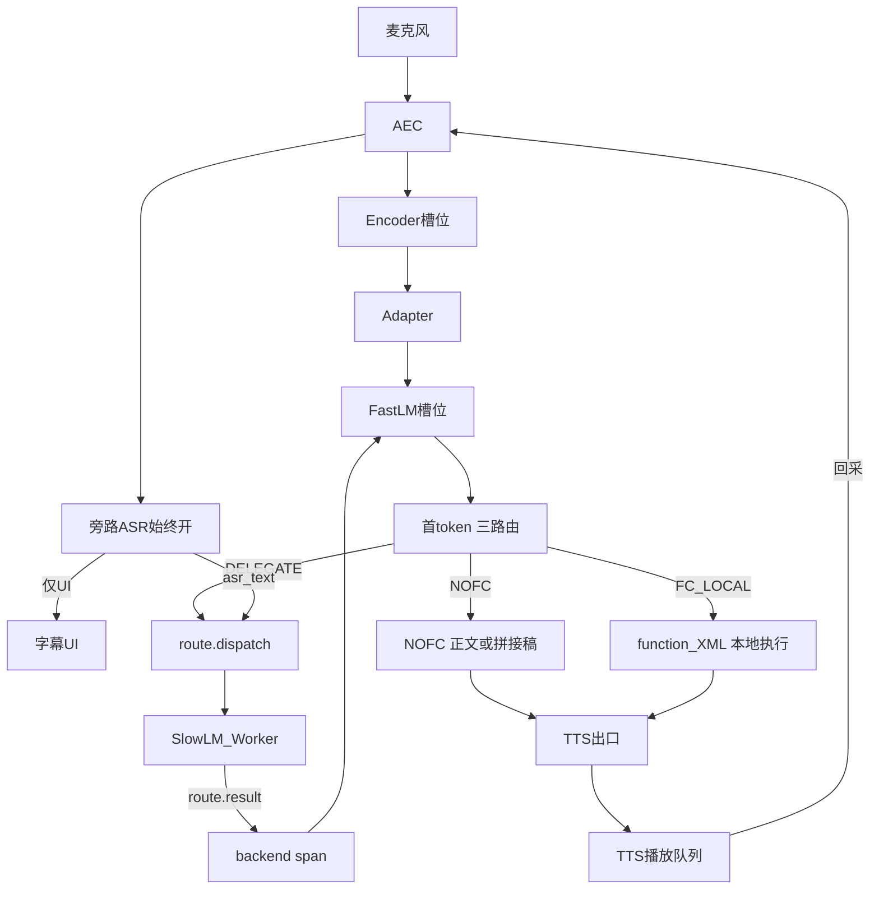

# ranAudio 架构说明

> **日期**：2026-11-09  
> **架构标准**：[MiniCPM5-2B_音频门控架构定义.md](./MiniCPM5-2B_音频门控架构定义.md)（Draft **v0.3**）。**整体链路与协议以该文 §3.2 为准。**  
> 本文是实现对照：槽位怎么填、代码到哪、训练阶段怎么挂。不另起一套数据流，不改定义里的 OPEN / ASSUMPTION。  
> **v0.3 协议已改文档；代码 / 已训权重仍按旧 S2（FC+BASE+NOFC），实现另开。**  
> **回注落地**：Worker `speak` 包进 `<backend>…</backend>` 与当前音频同轮进 FastLM，拼 `<|NOFC|>` 再进 TTS。回注仍不得旁路直达扬声器。见 [S2 §2.1](./S2_FC_NOFC_训练计划.md)。  
> 代码：[`ranAudio/`](../ranAudio/)。Demo（平级）：[`../MiniCPM-o-Demo`](../../MiniCPM-o-Demo)。

版本契约（历史，不是目标链路）：[v1.0.md](./v1.0.md) · [v1.1.md](./v1.1.md) · [docs/README.md](./README.md)  
2B 原生 XML FC 实测：[minicpm5_fc_format.md](./minicpm5_fc_format.md)  
S1.5：[S1.5_SenseVoice_训练计划.md](./S1.5_SenseVoice_训练计划.md)  
S2 协议（v0.3 三路由字面 + 旧实测注记）：[S2_FC_NOFC_训练计划.md](./S2_FC_NOFC_训练计划.md)

---

## 1. 标准在说什么

全双工语音交互：**快时钟 FastLM** 常驻，三路由（简洁对话 / 本地 function call / 委派）；**旁路 ASR 始终开**；需要强推理或复杂工具链时，**慢时钟 SlowLM** 仅由 DELEGATE 触发。分工原则见定义 §1.1。

非目标（定义 §1.3，实现不得做）：2B 出语音 token、2B 多步规划、主动交互、视觉。SlowLM 仍默认一轮 FC。

核心决策是 **旁路 ASR 始终开 + FastLM 三路由**（定义 §2，相对 v0.2 翻转）：废除条件性 ASR / 一律 BASE 上抛。旁路 ASR → UI 字幕 + DELEGATE 的 `asr_text`；不得替代 FastLM 对 NOFC/LOCAL 的音频决策。

---

## 2. 目标链路（定义 §3.2）

§3.2 是唯一脊柱。协议、时钟、状态机都挂在这张图上。



四条铁律（定义 §3.2.1），实现不得走样：

1. `<|DELEGATE|>` 后 eos 即 emit；`asr_text` = 旁路 ASR。DELEGATE 后垫话标 **OPEN**。
2. emit 必须 fire-and-forget；快时钟不得 `await` SlowLM。本地 FC 在端侧执行。
3. 回注不得直达扬声器。本版先写入 `<backend>`，由 FastLM 拼 `<|NOFC|>` 再进 ④；L2 仍可拦「用户正在说」。
4. NOFC / 本地执行后话术 / 回注拼稿只进同一个 TTS 出口。旁路 ASR 与 SlowLM 不得直达扬声器。

分层：L0 信号（AEC / 麦 / TTS）→ L1 实时（Encoder + FastLM + **旁路 ASR**）→ L2 协调（流解析 / 本地 FC 执行器 / 总线 / 状态机 / 仲裁）→ L3 SlowLM Worker（仅 DELEGATE）→ L4 应用。详见定义 §3.1、§3.2.2。

时钟：快 80–160 ms，永不阻塞；慢 0.5–5 s，可取消（§5）。状态：`LISTEN` / `SPEAK` / `ROUTE_WAIT` / `DUAL` / `BARGE_IN`（§6）。用户正在说时不插播。

---

## 3. 输出协议（Draft v0.3）

字面以 [S2 §1](./S2_FC_NOFC_训练计划.md) 为准。**代码仍按旧 FC+BASE+NOFC。**

| 类 | 2B 整段输出 | 消费 |
|---|---|---|
| 对话 | NOFC + 闲聊回答或听写正文 | 本地送 TTS |
| 本地工具 | FC + LOCAL + `<function>` XML | L2 本地执行 |
| 委派 | DELEGATE | eos 上派；`asr_text`=旁路 ASR |
| BASE（历史） | FC + BASE + 转写 | 旧 S2 / 已训权重 |
| 回注轮 | 输入 backend + 音频 → NOFC 拼接稿 | 不回吐标签 |

字面如下：

```text
对话：    <|NOFC|>今天天气不错，适合出门。
听写：    <|NOFC|>今天会议取消了
本地工具： <|FC|><|LOCAL|><function name="enable_bluetooth">
</function>
委派：    <|DELEGATE|>
回注：    <backend>北京明天多云转晴，18到24度。</backend> + 音频
       →  <|NOFC|>查到了，北京明天多云转晴，18到24度。
```

SFT **默认不传 `tools=`**；LOCAL 靠 system / 示例教 XML，推理侧本地执行器解析。见 [minicpm5_fc_format.md](./minicpm5_fc_format.md)。  
`<backend>` 只出现在 user 输入。词表：保留现有 token，**新增 `<|DELEGATE|>`**，启用 `<|LOCAL|>`。

流式解析仍要处理半截 special token。上派字段见定义 §4.3。  
[`protocol.py`](../ranAudio/protocol.py) **仍为旧 S2**（`S2_SPECIAL_TOKENS` / `wrap_backend`）；三路由实现另开。

---

## 4. 槽位填充（定义 §3.2.4）

型号是候选，可换；换了只重做 §10 训练规格，链路与协议不变。

| 槽位 | 必须满足 | 当前填充 | 代码 |
|---|---|---|---|
| Encoder | 流式、chunk-causal；AEC 残差 → 音频表示 | **SenseVoice-Small**（512-d；Whisper 仅 v1.0 对照） | [`sensevoice_apm.py`](../ranAudio/sensevoice_apm.py) |
| 旁路 ASR | 始终可出转写；服务 UI + DELEGATE `asr_text` | **OPEN**（可与 S1.5 前端共用） | **未做** |
| Adapter | 音频表示 → FastLM 隐空间 | `Linear 512→2048` projector | [`model.py`](../ranAudio/model.py) |
| FastLM | 端侧常驻；首 token NOFC / FC / DELEGATE；LOCAL 后吐合法 XML | **现网编排**仍偏旧协议；MiniCPM5-2B `mix_*` 为旧 S2 对照 | [`step_route/`](../ranAudio/step_route/) / [`model.py`](../ranAudio/model.py) |
| SlowLM | **仅 DELEGATE**；一轮 FC → speak；可 cancel / `no_op` | 现网仍吃旧 BASE 转写；待改为旁路 ASR 上下文 | [`step_route/slowlm.py`](../ranAudio/step_route/slowlm.py) |
| TTS | 文本进、音频出 + 回采给 AEC | **OPEN** | 未做 |

栈（已实现的 L1 离线前向）：

```text
wav 16kHz
  → SenseVoice frontend（80-mel + LFR 7/6）+ SANM encoder（512）
  → MultiModalProjector（512 → 2048）
  → 替换 chat 中 <|audio_pad|> embedding
  → MiniCPM5-2B
```

维护：

- 默认 `encoder_backend=sensevoice`。`--encoder-backend whisper` 仅 v1.0 对照；Whisper 须 pad 到 3000 mel 再 crop。
- 禁止加载 `runs/align/`、`runs/fc/` 的 Whisper 1024-d projector 到 SenseVoice 路径。
- `generate_text` 须 `skip_special_tokens=False`（`<|FC|>` / `<|NOFC|>` / `<function` 都是结构标签）。
- 底座出 XML FC 靠 `tools=` 进 chat template，格式是 `<function`…`</function>`，不是 `<tool_call>` JSON。S2 路由训练 **不要** 传 `tools=`，否则会跳过 `<|FC|>` / `<|NOFC|>` 直接出 XML。见 [minicpm5_fc_format.md](./minicpm5_fc_format.md)。

---

## 5. 训练阶段（定义 §10）

针对当前 FastLM 候选。2B **不得全参**。

| 阶段 | 定义目标 | 实现状态 |
|---|---|---|
| S0 模态对齐 | 冻 2B，训 encoder + adapter | 被 S1.5 取代（SenseVoice 已预训练） |
| S1 流式化 | encoder 改 chunk-causal | **未做** |
| **S1.5 ASR** | 冻 2B，转写沉到 encoder / 旁路 ASR 前端 | **已完成**：a / b-S / b-MS 均过出门线。数字见 [S1.5_SenseVoice_训练计划.md](./S1.5_SenseVoice_训练计划.md) §9 |
| S2 三路由 SFT | NOFC / FC+LOCAL / DELEGATE | **协议 Draft v0.3 已改文档**；权重仍为旧 FC+BASE+NOFC（`mix_boundary` 等）。三路由实现另开 |
| S3 路由校准 | 扫 LOCAL↔DELEGATE↔NOFC | 未做 |
| S4 双工专项 | 重叠 / 回声 / 打断 | 未做；定义明确此时才碰 duplex |

S1.5 结束时模型「只会转写」是预期；旁路 ASR 质量仍依赖此阶段。旧 S2 解锁的是 FC+BASE+NOFC；**v0.3 目标**为三路由，LOCAL 出 XML、DELEGATE 不上吐转写。负例：能答对 → NOFC；简单槽位 → LOCAL；复杂 → DELEGATE（定义 §10.4）。

脚本：

| 阶段 | 脚本 | 说明 |
|---|---|---|
| S1.5 | [`train_s15_asr.py`](../ranAudio/train_s15_asr.py) | 冻 2B；SenseVoice + 新 projector；`--keep-best 5` |
| S2 | [`train_s2_full.py`](../ranAudio/train_s2_full.py) / [`train_s2_route.py`](../ranAudio/train_s2_route.py) | 全参课程已跑完，当前 LLM 在 `runs/s2_fc_nofc_full/mix_boundary`。投影层单独续训见 [S2 §9](./S2_FC_NOFC_训练计划.md) |
| Align / FC / Judge | `train_align.py` / `train_fc.py` / `train_judge.py` | **历史**。Whisper 对齐与 v1.0/v1.1，不进 §3.2 主路径 |

---

## 6. 实现进度（对照标准）

| 标准块 | 状态 |
|---|---|
| L1 Encoder + Adapter + FastLM 离线前向 | 有。SenseVoice + projector + 2B |
| S1.5 转写沉淀 | **收官完成**。数字见 S1.5 §9。构音旁路独立，不进主路径 |
| **v0.3 协议文档** | **已改**（旁路 ASR + 三路由）。见定义 Draft v0.3 / [S2 §1](./S2_FC_NOFC_训练计划.md) |
| §4 标签常量与解析（v0.3） | **代码未跟**：`protocol.py` 仍为旧 S2（无 DELEGATE；LOCAL 未训）；三路由实现另开 |
| 旁路 ASR 始终开 | **未做** |
| L0 AEC / 麦 / TTS / 回采 | **不做**（直至 S4；定义 §1.3） |
| L2 流解析 / 本地 FC 执行器 / 总线 / 五状态 / 播报仲裁 | **未做** |
| L3 SlowLM Worker（仅 DELEGATE；`asr_text`=旁路 ASR） | **未做**。现有路径仍吃旧 BASE 转写 |

当前可跑的是 **离线单轮旧协议**：一条 wav → `generate` → FC+BASE / NOFC。不是全双工主循环，也不是 v0.3 三路由。

---

## 7. 历史基线（不是目标链路）

v1.0 / v1.1 / 旧 S2（FC+BASE）只保留作对照，**不得**当 v0.3 §3.2 的实现规格。

| | v1.0 | v1.1 | 旧 S2（代码现状） | 目标 v0.3（定义 §3.2） |
|---|---|---|---|---|
| 2B 输出 | MiniCPM5 XML `<function>` | `{"asr","need_fc","reply?"}` | FC+BASE+转写 / NOFC | NOFC / FC+LOCAL+XML / DELEGATE |
| 转写 | 无 | **两边都有 asr** | 命令路径 BASE 后 | **旁路 ASR 始终**；DELEGATE 用其 `asr_text` |
| 执行 | 2B 填槽后停 | `need_fc` 才打 Slave | BASE eos → SlowLM | 简单槽位本地；复杂才 DELEGATE |
| 交互 | 离线单轮 | 离线单轮 | 离线单轮 | 全双工快/慢时钟 |
| 评测 | car_fc **22/22** | 判官 | 路由 1.0（旧协议） | §9 三路由 + 旁路 ASR CER |

MiniCPM-o 全双工（Gateway + 1s unit + FCAssembler）是另一条产品线，listen/speak/FC **不得**下沉到 Gateway。和 ranAudio 版本号独立。

缺必填槽（`destination` / `level` / `degrees`）仍由 Registry 失败，禁止静默默认——这条对 SlowLM 同样成立。

---

## 8. 产物

| 产物 | 路径 | 用途 |
|---|---|---|
| **S1.5b-MS 最好 encoder / projector（旧 S2 编码侧）** | `runs/s15_asr/b_ms_cont/encoder_best.pt`、`projector_best.pt` | 原 `mix_boundary` 所用 |
| S1.5 解冻 2B 续训 best | `runs/s15_asr/b_ms_llm_cont/{llm,encoder,projector}_best*` | 纯转写上限 CER 0.0179；编码侧进 `mix_llmcont` |
| **S2 路由 LLM（当前体验默认）** | `runs/s2_fc_nofc_full/mix_llmcont/` | resume boundary + llm_cont enc/proj；route 1.0；asr CER 0.259 |
| S2 路由 LLM（实验前） | `runs/s2_fc_nofc_full/mix_boundary/` | route 1.0；asr CER ~0.267 |
| S1.5b-S 最好 encoder / projector | `runs/s15_asr/b_s/encoder_best.pt`、`projector_best.pt` | MS 起点 |
| S1.5a projector | `runs/s15_asr/a/projector_best.pt` | b-S 起点 |
| 构音旁路 e2 | `runs/s15_asr/dysarthric_e2/*_best.pt` | 旁路专用；**不要**接到 S2 默认路径 |
| S1.5 收官 json | `tmp/s15_b_ms_cont_aishell_full.json`、`tmp/s15_b_ms_cont_test_net.json`、`tmp/s15_b_ms_cont_car22.json` | 全量评测逐条 |
| v1.0 Align / FC | `runs/align/projector.pt`、`runs/fc/` | Whisper 基线，禁止接到 SenseVoice |
| v1.1 判官 | `runs/judge/`、`data/judge_audio.jsonl` | 历史；S2 不要打补丁 |
| 评测 | `tmp/minicpm5_car_fc_eval.json`、`tmp/minicpm5_fc_probe.json` | v1.0 / 底座 XML 探针 |

尝试方案总表（含是否进主路径）：[S1.5 §9.9](./S1.5_SenseVoice_训练计划.md) / [S2 §10](./S2_FC_NOFC_训练计划.md)。体验页默认 `mix_llmcont` + `b_ms_llm_cont` 编码侧。未到 S2 之前不要把 v1.0 LoRA 和 SenseVoice projector 混装。
