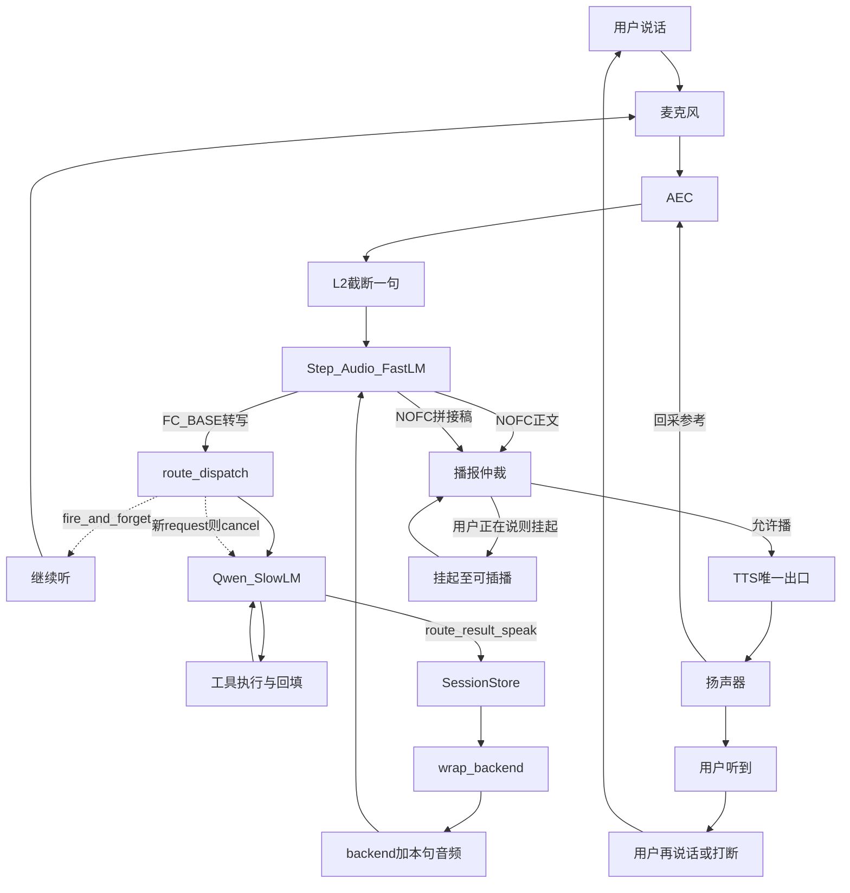
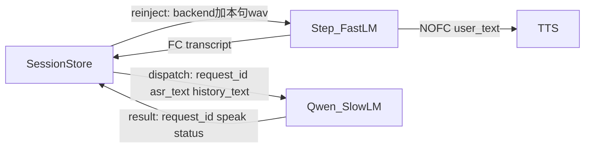

# Step-Audio FastLM + Qwen3.5-2B SlowLM（设计整理）

> **日期**：2026-11-04  
> **性质**：把快慢链路、类双工、截断、回注、训练与上下文契约整理成一份说明。  
> **协议脊柱**：与 [`../docs/architecture.md`](../docs/architecture.md) §3.2、[`../docs/S2_FC_NOFC_训练计划.md`](../docs/S2_FC_NOFC_训练计划.md) 同一套字面；只换槽位填充与编排。  
> **代码骨架**：[`step_route/`](./step_route/)（离线 demo 已有；双工/截断/SessionStore/训练造数按本文后续落地）。  
> **流式运行时**：[`step_route/REALTIME_FASTLM.md`](./step_route/REALTIME_FASTLM.md)（偏实时改造的实现说明、基线与环境约束，随里程碑同步更新）。

MiniCPM5 S2 与 [`demo_s2.py`](./demo_s2.py) **保留作对照**，不是本链路默认 FastLM。

---

## 1. 结论

| 槽位 | 填充 | 输入 | 职责 |
|------|------|------|------|
| FastLM | Step-Audio-2-mini | 原始 wav（± `<backend>` 文本） | 路由、条件性转写、本地快答、回注拼接 |
| SlowLM | 本机 Qwen3.5-2B | **仅** BASE 后转写（+ 可选文本历史） | 复杂推理 / 工具 → `speak` |
| TTS 出口 | 文本进 | **只**来自 FastLM 的 `<|NOFC|>` 正文 | 用户唯一可听出口 |
| L2 | 编排 / 截断 / SessionStore | 事件 | 组串、仲裁、cancel、上下文真相 |

已拍板的取舍：

- **无 Jev**；档位 = FastLM 首段 `NOFC` / `FC+BASE`。  
- **无旁路上派 ASR**；转写是 FastLM 在 BASE 后自己吐的。  
- **SlowLM 不直连扬声器**；必须 `<backend>` 回注后再由 FastLM 出播报。  
- **类全双工 + 允许时延**（端点后秒级内可接受）；**不做** 80–160ms SenseVoice chunk 硬实时，也 **不** 等 Step 输入侧流式 API。  
- Step 内部 25s mel 分片只是实现细节，**不是**语义句边界。

---

## 2. 完整交互闭环



两圈：

1. **快闭环**：说 → 截断 → `NOFC` → TTS → 听  
2. **慢闭环**：说 → `FC+BASE` 上派（不阻塞听）→ SlowLM → Store → `backend`+本句音频 → `NOFC` 拼接 → TTS → 听  

四条铁律（定义 §3.2.1）：

1. BASE 后 eos 即 emit，FastLM 不出垫话。  
2. emit fire-and-forget（快时钟不 `await` SlowLM）。  
3. 回注是事件不是出声；禁止 `slow_speak` 直写 TTS。  
4. 唯一 TTS 汇合点：`user_text` ← FastLM NOFC。

---

## 3. 协议字面

复用 [`protocol.py`](./protocol.py)：

```text
理解：  <|NOFC|>今天天气不错，适合出门。
命令：  <|FC|><|BASE|>打开蓝牙
回注：  <backend>北京明天多云转晴，18到24度。</backend> + 可选音频
     →  <|NOFC|>查到了，北京明天多云转晴，18到24度。
```

- 首 token 只能是 `<|FC|>` 或 `<|NOFC|>`。  
- `<|FC|>` 后本版固定 `<|BASE|>`，再跟**用户原话转写**（禁止助手口吻）。  
- 听写归 NOFC；本版不训 `<|FC|><|LOCAL|>`，Fast **不出**工具 XML。

### 3.1 FastLM 怎么知道是回注轮

**模型不猜模式。** 权威信号是 user 串里有没有 `<backend>…</backend>`：

| 层级 | 行为 |
|------|------|
| L2 | 有 `pending_speak` 且未 cancel → 调 reinject，组串带上 backend |
| User 输入 | 出现 `<backend>` → 回注轮；否则路由轮 |
| System | demo 可用 `REINJECT_SYSTEM` 加固；训好后可只靠 backend 标签 |
| 模型 | 学「有 backend ⇒ 只出 NOFC、不上派」 |

禁止：路由轮误塞 backend；回注轮去掉 backend 却仍期望只播报。不另造第三套路由 token。

### 3.2 两套前向

| 前向 | 输入 | 输出 |
|------|------|------|
| `route` | 仅本句 wav | `NOFC` 快答 **或** `FC+BASE`+转写 |
| `reinject` | **必有** backend ± 本句 wav | **仅** `NOFC` 拼接稿 |

Step 同轮支持 text+audio（`content` list）。共输入形态：

```python
{"role": "human", "content": [
    {"type": "text", "text": "<backend>…</backend>\n"},
    {"type": "audio", "audio": wav},  # 可选
]}
```

有 backend 时：事实原样进播报；音频作 Cond（追问/嗯）；**本轮禁止 FC**。真新命令由 L2 **不塞**旧 backend，另开纯音频 `route`。

---

## 4. 类全双工（允许时延）

目标是**交互形态**像全双工（可重叠听、回注可与当前句共输入、可打断），不是 80–160ms 硬实时 chunk FastLM。

| | 硬实时 chunk | **本方案** |
|--|--|--|
| FastLM | SenseVoice chunk-causal 持续解码 | Step **整句/短段**，端点或短窗触发 |
| 时延 | 首包数百 ms | **放宽**：端点后 Step 跑完再出声（约 1–2s 可接受） |
| 麦 | 常开 | **常开**（上派/播报也不关） |

### 4.1 音频截断（L2 负责，Step 不切语义）

Step 入侧会把 wav 按最多 **25s** 拆成多个 `<audio_start>`（实现分片），**不能**当句边界。

| 规则 | 默认 | 行为 |
|------|------|------|
| 静音端点 | 尾静音 400–600 ms | 导出本句 PCM → route/reinject |
| 最短句 | ~300 ms 有效语音 | 更短当噪音 |
| 最长句 `max_utt` | **15 s**（&lt; 内部 25s） | 强制截断；余下算下一句 |
| 回注 | 只用**刚截断的那一句** + backend | 禁止无限历史波形 |
| 打断 | barge_in / 新 `request_id` | 旧半句作废、cancel、清 pending；新点重开缓冲 |
| hold | SlowLM 到但用户还在说 | 先不 reinject；等本句端点再共输入 |

原则：**一句一前向**；对话历史用**文本**留在 SessionStore / messages，音频只带本句。

### 4.2 与用户输入「同时」时的仲裁

| 情形 | 处理 |
|------|------|
| SlowLM 到、用户静默 | 立刻 reinject（可无音频） |
| SlowLM 到、用户正说 | **hold**；端点后 backend+本句 wav |
| 已新上派 / barge_in | **drop** 旧 speak；cancel 旧 Worker |
| 同 tick 两者都到 | **用户侧优先**，再按上表判 SlowLM |

`speak=null` / `no_op`：不播，与用户无冲突。

---

## 5. FastLM ↔ SlowLM 上下文

**不共享** 模型 KV。唯一真相在 L2 **SessionStore**：



| 字段 | 谁写 | 谁读 | 含义 |
|------|------|------|------|
| `session_id` | L2 | 双方 | 会话 |
| `history_text[]` | 每轮 NOFC/播报后追加 | Slow（可选）、Fast 文本史 | 用户可见摘要，**无**原始 wav |
| `last_transcript` | Fast BASE 后文本 | Slow 本轮 | 上派唯一文本源 |
| `request_id` | 每次 FC emit | cancel / 丢过期 result | |
| `pending_speak` | Slow result | reinject | 未消费 backend 载荷 |
| `anchor_time` | emit 时 | 仲裁 | |

传输：

- Fast→Slow：`{request_id, asr_text, history_text?}`，**不传音频**。  
- Slow→Fast：不直连；经 Store 打成 `<backend>` 再共输入。  
- Cancel：新 id / barge_in → 清 `pending_speak`，Worker 丢弃。  
- Slow 工具 trace 默认留在 Store/Worker，除非写成 backend 事实再回灌。

存储：demo 用进程内 dict；接口形状稳定后再换 Redis。

---

## 6. FastLM 如何训练

Step 上**重做** S2 课程（不搬 MiniCPM 权重）。开训前词表一次加齐：  
`<|FC|>` `<|NOFC|>` `<|LOCAL|>` `<|BASE|>` `<backend>` `</backend>`（见 `protocol.py`）。

### 6.1 三桶

| 桶 | 输入 | 监督 | 目的 |
|----|------|------|------|
| route | 要外部能力的音频 | `<|FC|><|BASE|>`+用户原话转写 | 钉住漏上派 |
| chat | 能本地答的音频 | `<|NOFC|>`+非复读回答；听写则正文 | 禁复读、听写陷阱 |
| backend | `<backend>事实</backend>` ± 用户 Cond 音频 | `<|NOFC|>` 拼接稿 | 回注保真、本轮不上派 |

负例：模型能答对的标 NOFC，勿标 FC。召回优先：漏 FC 代价最高。  
Wenet 整表**不要**打成 FC。S2 **不要**传 `tools=`。

**Step 可用路由/闲聊/听写数据（已从 S2 表导出，2026-11-04）**：

| 文件 | n | 用途 |
|------|---|------|
| [`data/step_s2_route.jsonl`](../data/step_s2_route.jsonl) | 5631 | 课程 phase=route |
| [`data/step_s2_chat.jsonl`](../data/step_s2_chat.jsonl) | 2612 | phase=chat |
| [`data/step_s2_asr.jsonl`](../data/step_s2_asr.jsonl) | 2510 | phase=asr（听写） |
| [`data/step_s2_mix.jsonl`](../data/step_s2_mix.jsonl) | 10753 | mix |
| [`data/step_s2_test.jsonl`](../data/step_s2_test.jsonl) | 82 | 评测 |
| [`data/step_s2_backend.jsonl`](../data/step_s2_backend.jsonl) | 2800 | phase=backend 回注 |

每行含绝对路径 `wav` 与 Step `messages`：`system=ROUTE_SYSTEM` → `human` 音频 → `assistant=target`。  
重生路由/闲聊/听写：`python -m ranAudio.step_route.export_step_sft`（源表 `s2_audio_boundary.jsonl`）。  

**回注桶**：`python -m ranAudio.step_route.gen_step_backend`  
- human：`<backend>speak</backend>`，Cond = none / 同句 wav / chat 短句 / 追问 wav（`data/step_backend_cond_wavs/`，Qwen3-TTS）  
- assistant：`<|NOFC|>` + 可选衔接 + **原样 speak**  
- system：`REINJECT_SYSTEM`
### 6.2 课程

1. route → 2. chat → 3. backend → 4. mix  
路由 token loss ≥ 1.0；BASE 后转写可降权。  

验收：route_acc、FC CER、复读率、backend 数字/专名保真、有 backend 时零 FC。

### 6.3 与 runtime 分工

- 「打开空调」打断旧天气回注：靠 **L2 不塞旧 backend**，不靠回注轮模型改出 FC。  
- backend 桶造：无音频 / 嗯 / 追问 / 短无关句；无关句仍 NOFC 先播事实。

---

## 7. 现有代码与怎么跑

| 文件 | 作用 |
|------|------|
| `step_route/protocol_step.py` | ROUTE/REINJECT system、解析；`verify_backend_fact` 入口 |
| `step_route/fastlm.py` | Step `route` / `reinject`；抽出 `route_messages` / `reinject_messages` / `prepare_inputs` |
| `step_route/slowlm.py` | Qwen worker + Client；`request_id` 透传与 `cancel` |
| `step_route/pipeline.py` | 同步 `StepRoutePipeline` 基线（不变）+ 流式入口 `RealtimePipeline` |
| `step_route/demo_step_route.py` | 多 wav demo（`--mode` 四选一，默认 baseline 行为不变） |
| `step_route/bench_realtime.py` | 四模式 harness + 分段时延 / 保真 / 基线对比报告 |
| `step_route/events.py` | `StreamEvent` / `Utterance` / `Clock`：唯一事件契约 |
| `step_route/stream_protocol.py` | 增量协议解析（半截 tag、首路由）+ 回注事实保真兜底 |
| `step_route/vad.py` | 能量/静音端点、max_utt、barge_in（L0 替身，无 AEC） |
| `step_route/session_store.py` | §5 六字段 + 多活跃请求、cancel / 仲裁 |
| `step_route/fastlm_base.py` | `FastLMBackend` Protocol + `RecordedBackend`（回放历史输出并注入实测时延） |
| `step_route/fastlm_stream.py` | Step 流式后端：`TextIteratorStreamer` 线程化 generate，workspace 内拼输入 |
| `step_route/fastlm_minicpm.py` | MiniCPM5 首 token 门控 + 前缀 chunk 探针（独立 worker，稳态首 token 83–116ms） |
| `step_route/coordinator.py` | L2 异步编排：fire-and-forget、hold/drop 仲裁、单一播报出口 |
| `step_route/test_realtime.py` | no-GPU 单测（10 组已通过） |
| `step_route/REALTIME_FASTLM.md` | 流式运行时说明、运行命令与改造前后对比报告 |

```bash
cd /cmy/cmy/ranAudio
PY=/cmy/cmy/Step-Audio/venv/bin/python

# 同步基线（默认行为不变）
$PY -m ranAudio.step_route --wav ... --out /tmp/step_route_results.json

# 四模式基准：baseline / offline-events / step-stream / minicpm-probe
$PY -m ranAudio.step_route.bench_realtime --mode offline-events \
  --out /tmp/realtime_offline.json --report /tmp/realtime_offline.md
# 完整命令与产物见 step_route/REALTIME_FASTLM.md §4
```

| 进程 | Python |
|------|--------|
| FastLM | `/cmy/cmy/Step-Audio/venv/bin/python` |
| SlowLM | `qwen3-compare` + `PYTHONPATH=.../transformers-main/src` |

---

## 8. 与旧方案

| 旧 | 现 |
|----|----|
| ASR→Jev→选模型 | FastLM 自门控 |
| HANDOFF 再调旁路 ASR | BASE 后转写即上派源 |
| SlowLM 直通 TTS | 禁止；必须 backend→FastLM |
| 硬实时 chunk FastLM | 类双工 + 允许时延 + Step 整句 |
| 快慢共享 KV | SessionStore 文本契约 |

---

## 9. 已做 / 未做

**已有**：离线 route→slow→reinject demo；协议解析；S2 数据导出与 backend 造数（`data/step_s2_*.jsonl` 共 24406 行，含 2800 条 backend）；本文设计整理；**基线时延采集 harness**（`bench_realtime.py --mode baseline`，实测 mean total 4.775s / p50 4.404s）。  

**已落地（2026-11-05）**：偏实时流式运行时全套，见 [`step_route/REALTIME_FASTLM.md`](./step_route/REALTIME_FASTLM.md) —— 事件模型、流式解析、VAD、SessionStore、可插拔 FastLM 三后端、L2 真 fire-and-forget 与 `request_id`/`cancel`、四模式基准与对比报告；10 组 no-GPU 单测通过，同步 `StepRoutePipeline` 基线行为不变。  

**实测结论**：保留 Step 整句底座只做到「不阻塞」——同集三条 FC 的 `total_s` 仅 +6–9ms 编排开销，但快时钟到 emit 即回到听（`fast_loop_s` 1.3–3.8s），且回注事实保真由 L2 兜底修复（基线 3/3 失真）。换 MiniCPM5 首 token 门控底座才真提速：稳态首路由 **83.8ms**、端到端 **0.281s**（该模式未挂 SlowLM、回注为结构化拼接）。`step-stream` 因 Step venv 的 `huggingface-hub==2.4.0` 冲突未实跑，基准产出结构化 error 行，不伪造数据。前缀 chunk 探针稳态 99–122ms/chunk，但累计含 warmup 2.68s，属 O(k²) 重编码近似，不是 chunk-causal。  

**未做（按本文后续）**：Step SFT 与词表加齐、S1 chunk-causal 重训、真 AEC/TTS/麦克风、真实工具后端与 SlowLM 挂载、修复 Step venv 依赖后复跑 `step-stream` 基准。  

**已知限制（prompt-only Step）**：BASE 易带助手口吻；回注标签偶发缺竖线——解析可归一化，质量靠后续 SFT。  

**环境限制（2026-11-05）**：Step venv 的 `huggingface-hub==2.4.0` 与 transformers 4.49 冲突，当前无法加载 Step 基座；GPU 仅余约 10.4GB，Step-Audio-2-mini（~16.5GB）放不下，MiniCPM5-2B 可跑。详见流式运行时文档 §3。
